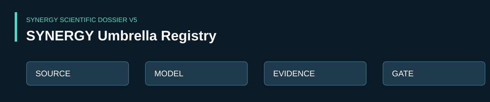
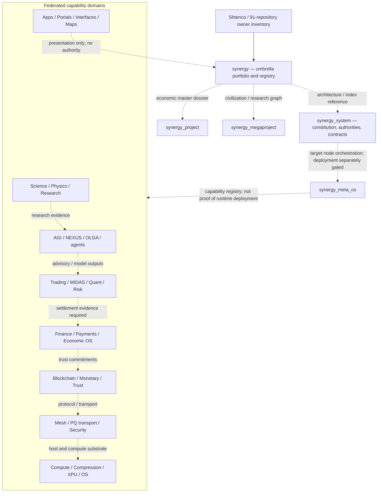

<!-- SCIENTIFIC-V5-2026:START -->


**[Научное досье V5](docs/SCIENTIFIC_DOSSIER_V5_2026.md)** — source inventory, acceptance gates, ограничения и проверки. **Статус:** GOVERNANCE ROOT. Исторический текст README сохранён ниже.

<!-- SCIENTIFIC-V5-2026:END -->

# SYNERGY

> **Private master umbrella repository for the SYNERGY ecosystem.**

This repository is the **single entry point, architecture map, module registry and integration layer** for the SYNERGY family of repositories owned by `Shtenco`.

## Purpose

`Shtenco/synergy` does **not** replace or merge the source history of the child repositories.

Each subsystem keeps its own repository, issues, pull requests, releases and CI/CD. This master repository provides:

- one canonical map of the whole ecosystem;
- a machine-readable registry of SYNERGY modules;
- architecture and dependency documentation;
- common integration contracts;
- a place for cross-repository roadmaps and system-level decisions;
- automation hooks for NEXUS / Autopilot / AI-company orchestration.

## Current scope

The live owner inventory now reconciles **91 / 91 repositories (16 public, 75 private)** visible to the installed GitHub App. The deep M0 capability audit remains the **81-repository baseline dated 2026-10-08**; ten later additions are recorded with explicit per-repository maturity and evidence limits. This owner inventory is not the same as the 75-record interface registry maintained by `synergy_system`. Membership is determined by **content, role and cross-repository references**, not only by the word `SYNERGY` in the repository name.

**Security gate (2026-11-20): 4 unresolved P0 credential/security blockers** are registered. Three previously tracked incidents remain in `synergy_cashero`, `synergy_usds` and `synergy_turbo_linux`; a fourth was detected in `synergy_ai_trade_terminal`, where non-placeholder broker username/password literals coexist with authentication and order-placement code. Broker-side validity and external rotation/revocation for the new finding are unverified. All four are deployment-blocked pending evidence; TURBO is also federation-promotion-blocked. See the [security blocker registry](https://github.com/Shtenco/synergy_system/blob/main/registry/SECURITY_BLOCKERS.json) and [security re-audit](https://github.com/Shtenco/synergy_system/blob/main/docs/SECURITY_REAUDIT_2026-11-20.md).

**Branch protection:** GitHub reported 0/1,292 branch refs protected, including all 91 `main` branches. This is a repository-governance risk; the census is a 2026-11-20 snapshot. **Live branch-name recheck (2026-11-20):** all 91 repositories were queried again with pagination; every live branch-name set and count matched the canonical snapshot exactly. HEAD SHAs remain the dated snapshot values and were not individually re-fetched in this recheck.

The canonical artifacts are:

- [registry/repos.json](registry/repos.json) — full 91-repository inventory
- [registry/master_graph.json](registry/master_graph.json) — capability/dependency graph
- [docs/M0_MASTER_INTEGRATION.md](docs/M0_MASTER_INTEGRATION.md) — M0 audit
- [docs/MASTER_GRAPH.md](docs/MASTER_GRAPH.md) — human-readable graph
- [docs/ARCHITECTURE.md](docs/ARCHITECTURE.md)
- [docs/INTEGRATION.md](docs/INTEGRATION.md)
- [Full branch inventory JSON](registry/BRANCH_INVENTORY_2026-11-20.json) — 1,292 branch refs / 91 repositories
- [Full branch inventory CSV](registry/BRANCH_INVENTORY_2026-11-20.csv) — one row per branch
- [Branch inventory report](docs/BRANCH_INVENTORY_2026-11-20.md)
- [Live branch-name recheck — all 91 repositories](docs/BRANCH_LIVE_RECHECK_2026-11-20.md)
- [Live branch audit — core federation (117 branches / 95 open PRs)](docs/LIVE_BRANCH_AUDIT_CORE_FEDERATION_2026-11-20.md)
- [Live branch audit — agent systems (125 branches / 45 open PRs)](docs/LIVE_BRANCH_AUDIT_AGENT_SYSTEMS_2026-11-20.md)
- [Live branch audit — science, coder and trading terminal (21 branches / 13 open PRs)](docs/LIVE_BRANCH_AUDIT_EVIDENCE_CODER_TRADING_2026-11-20.md)
- [Live branch audit — trading and investment (41 branches / 5 open PRs)](docs/LIVE_BRANCH_AUDIT_TRADING_INVESTMENT_2026-11-20.md)
- [Live branch audit — financial OS, payments and USDS (77 branches / 65 open PRs)](docs/LIVE_BRANCH_AUDIT_FINANCIAL_PAYMENTS_USDS_2026-11-20.md)
- [Live branch audit — token, host compute and blockchain budget (37 branches / 9 open PRs)](docs/LIVE_BRANCH_AUDIT_TOKEN_HOST_BUDGET_2026-11-20.md)
- [Live branch audit — high-branch AI language and binary/quantum research (307 branches / 76 open PRs)](docs/LIVE_BRANCH_AUDIT_HIGH_BRANCH_RESEARCH_2026-11-20.md)
- [Live branch audit — financial AI and blockchain core (92 branches / 58 open PRs)](docs/LIVE_BRANCH_AUDIT_FINANCIAL_AI_BLOCKCHAIN_2026-11-20.md)
- [Live branch audit — apps, messaging and GLLM Nexus (73 branches / 28 open PRs)](docs/LIVE_BRANCH_AUDIT_APPS_MESSAGING_GLLM_2026-11-20.md)
- [Live branch audit — Eurasian, Megaproject and Cold Nuclear (22 branches / 12 open PRs)](docs/LIVE_BRANCH_AUDIT_EURASIA_MEGAPROJECT_COLD_NUCLEAR_2026-11-20.md)
- [Live branch audit — compute, compression and XPU hardware (25 branches / 13 open PRs)](docs/LIVE_BRANCH_AUDIT_COMPUTE_COMPRESSION_XPU_2026-11-20.md)
- [Live branch audit — QE and alternative money systems (17 branches / 13 open PRs)](docs/LIVE_BRANCH_AUDIT_QE_ALTERNATIVE_MONEY_2026-11-20.md)
- [Consolidated live branch registry — JSON](registry/LIVE_BRANCH_AUDIT_2026-11-20.json) — 890 branch records / 26 repositories
- [Consolidated live branch registry — CSV](registry/LIVE_BRANCH_AUDIT_2026-11-20.csv) — SHA, purpose, PR, CI evidence and disposition
- [High-branch repository / BQG evidence audit](docs/HIGH_BRANCH_REPOSITORY_AUDIT_2026-11-20.md)
- [Eight-repository source audit delta](docs/REPOSITORY_AUDIT_DELTA_2026-11-20.md) — trading terminal, NEXUS/OLGA, Autopilot, Investment Committee, Market Graph, Science Agent, AI Coder and AGI Trader
- [Open PR / branch map JSON](registry/OPEN_PR_BRANCH_MAP_2026-11-20.json) — all 548 open PRs
- [Open PR / branch map CSV](registry/OPEN_PR_BRANCH_MAP_2026-11-20.csv) — one row per open PR
- [Open PR audit report](docs/OPEN_PR_BRANCH_AUDIT_2026-11-20.md)
- [Branch / PR coverage matrix CSV](registry/BRANCH_PR_SUMMARY_2026-11-20.csv)
- [Branch / PR coverage report](docs/BRANCH_PR_SUMMARY_2026-11-20.md)
- [Branch hygiene candidates CSV](registry/BRANCH_CLEANUP_CANDIDATES_2026-11-20.csv)
- [Branch hygiene review report](docs/BRANCH_CLEANUP_CANDIDATES_2026-11-20.md)

## System map

```text
SYNERGY
├── AGI / Agentic Company
│   ├── NEXUS
│   ├── Autopilot
│   ├── AI Company
│   ├── AI Coder
│   ├── Science / workforce agents
│   └── Long-term Harness (main is design-only)
├── Trading / Quant
│   ├── MIDAS
│   ├── QuantLab
│   ├── RiskGuard
│   ├── Market Graph
│   ├── Market Maker
│   ├── Relative Value
│   └── TradeMux / MarketVision / Adaptive Engine
├── Finance / Economy
│   ├── Financial OS
│   ├── Payment System
│   ├── USDS
│   ├── QE engines
│   ├── Triangle Money System
│   └── Agentic AI Economy
├── Blockchain / Protocol
│   ├── AI Blockchain
│   ├── Synergy Chain
│   ├── MetaChain
│   ├── budgeting / issuance modules
│   └── post-quantum transport
├── Compute / Compression / OS
│   ├── Turbo Linux
│   ├── Meta OS
│   ├── XPU / Motherboard
│   ├── GGUF / QR / AI compression
│   ├── computing topology / matrix engines
│   └── Shtenco Micro AI / MNN inference
├── Apps / Interfaces
│   ├── Super App
│   ├── Apps / Family
│   ├── Messenger
│   └── AI Trade Terminal
└── Search / Growth / Research
    ├── HardNAV Multiplier / Triangular Economy Simulator (synergy_search_engline)
    ├── Lead Search / Offline CRM Candidate
    └── experimental research modules
```


## Federation architecture map



**Interpretation:** solid arrows above represent inventory/ownership navigation only where explicitly stated; dotted relationships are architectural intent or documented federation relations. They do not prove imports, live API calls, deployed services, or E2E execution. Runtime edges remain separately evidence-gated.

## Full owner repository inventory — 91/91

The table below includes every current owner repository, including legacy, R&D, presentation, design-only and security-review nodes. Maturity is not a production certification. Branch count includes main and all non-main refs as of 2026-11-20.

| Repository | Domain | Maturity | Branches |
|---|---|---|---:|
| [`synergy_agentic_ai_economy`](https://github.com/Shtenco/synergy_agentic_ai_economy) | agi-agentic | RND_SIMULATION | 15 |
| [`synergy_agi_autopilot`](https://github.com/Shtenco/synergy_agi_autopilot) | agi-agentic | STUB_SPEC_ONLY | 29 |
| [`synergy_agi_nexus`](https://github.com/Shtenco/synergy_agi_nexus) | agi-agentic | CANDIDATE | 58 |
| [`synergy_agi_olga`](https://github.com/Shtenco/synergy_agi_olga) | agi-agentic | CANDIDATE | 38 |
| [`synergy_agi_trader`](https://github.com/Shtenco/synergy_agi_trader) | agi-agentic | CANDIDATE | 3 |
| [`synergy_ai_coder`](https://github.com/Shtenco/synergy_ai_coder) | agi-agentic | CANDIDATE | 8 |
| [`synergy_ai_company`](https://github.com/Shtenco/synergy_ai_company) | agi-agentic | STUB_SPEC_ONLY | 2 |
| [`synergy_ai_language`](https://github.com/Shtenco/synergy_ai_language) | agi-agentic | RND | 129 |
| [`synergy_gllm_nexus`](https://github.com/Shtenco/synergy_gllm_nexus) | agi-agentic | CANDIDATE | 48 |
| [`synergy_long_term_harness`](https://github.com/Shtenco/synergy_long_term_harness) | agi-agentic | STUB_SPEC_ONLY | 5 |
| [`synergy_nexus_science_agent`](https://github.com/Shtenco/synergy_nexus_science_agent) | agi-agentic | CANDIDATE | 8 |
| [`sinergy_app`](https://github.com/Shtenco/sinergy_app) | apps-interface | STUB_SPEC_ONLY | 1 |
| [`sinergy_super_app`](https://github.com/Shtenco/sinergy_super_app) | apps-interface | CANDIDATE | 7 |
| [`synergy_ai_workspace`](https://github.com/Shtenco/synergy_ai_workspace) | apps-interface | STUB_SPEC_ONLY | 11 |
| [`synergy_app`](https://github.com/Shtenco/synergy_app) | apps-interface | CANDIDATE | 4 |
| [`synergy_app_family`](https://github.com/Shtenco/synergy_app_family) | apps-interface | STUB_SPEC_ONLY | 1 |
| [`synergy_apps`](https://github.com/Shtenco/synergy_apps) | apps-interface | ARCHITECTURAL_MASTER | 11 |
| [`synergy_maps`](https://github.com/Shtenco/synergy_maps) | apps-interface | STUB_SPEC_ONLY | 10 |
| [`synergy_messenger`](https://github.com/Shtenco/synergy_messenger) | apps-interface | HARDENED_ALPHA | 14 |
| [`synergy_metaverse`](https://github.com/Shtenco/synergy_metaverse) | apps-interface | STUB_SPEC_ONLY | 10 |
| [`synergy`](https://github.com/Shtenco/synergy) | architecture-governance | ARCHITECTURAL_MASTER | 4 |
| [`synergy_project`](https://github.com/Shtenco/synergy_project) | architecture-governance | RND | 5 |
| [`synergy_system`](https://github.com/Shtenco/synergy_system) | architecture-governance | ARCHITECTURAL_MASTER | 62 |
| [`synergy_ai_blockchain`](https://github.com/Shtenco/synergy_ai_blockchain) | blockchain-protocol | CANDIDATE | 32 |
| [`synergy_chain`](https://github.com/Shtenco/synergy_chain) | blockchain-protocol | CANDIDATE | 29 |
| [`synergy_metachain`](https://github.com/Shtenco/synergy_metachain) | blockchain-protocol | CANDIDATE | 5 |
| [`synergychain.github.io`](https://github.com/Shtenco/synergychain.github.io) | blockchain-protocol | PRESENTATION_CANDIDATE | 52 |
| [`shtenco_micro_ai`](https://github.com/Shtenco/shtenco_micro_ai) | compute-os | RND_CANDIDATE | 1 |
| [`synegy_ai_compress`](https://github.com/Shtenco/synegy_ai_compress) | compute-os | CANDIDATE | 19 |
| [`synergy_ai_llm_rwkv`](https://github.com/Shtenco/synergy_ai_llm_rwkv) | compute-os | RND | 2 |
| [`synergy_complex_matrix_multiplication`](https://github.com/Shtenco/synergy_complex_matrix_multiplication) | compute-os | ACTIVE_EXPERIMENTAL | 1 |
| [`synergy_computing_topology`](https://github.com/Shtenco/synergy_computing_topology) | compute-os | ACTIVE_EXPERIMENTAL | 3 |
| [`synergy_gguf_compress`](https://github.com/Shtenco/synergy_gguf_compress) | compute-os | STUB_SPEC_ONLY | 10 |
| [`synergy_matrix_sota`](https://github.com/Shtenco/synergy_matrix_sota) | compute-os | STUB_SPEC_ONLY | 3 |
| [`synergy_meta_os`](https://github.com/Shtenco/synergy_meta_os) | compute-os | CANDIDATE | 33 |
| [`synergy_motherboard_xpu_xml`](https://github.com/Shtenco/synergy_motherboard_xpu_xml) | compute-os | CANDIDATE | 5 |
| [`synergy_qr_compress`](https://github.com/Shtenco/synergy_qr_compress) | compute-os | CANDIDATE | 12 |
| [`synergy_turbo_linux`](https://github.com/Shtenco/synergy_turbo_linux) | compute-os | SECURITY_REVIEW | 18 |
| [`print_money_synergychain`](https://github.com/Shtenco/print_money_synergychain) | finance-economy | STUB_SPEC_ONLY | 9 |
| [`synergistic_economics`](https://github.com/Shtenco/synergistic_economics) | finance-economy | RND_SIMULATION | 19 |
| [`synergy_2chain_qe`](https://github.com/Shtenco/synergy_2chain_qe) | finance-economy | RND_CANDIDATE | 5 |
| [`synergy_ai_economic`](https://github.com/Shtenco/synergy_ai_economic) | finance-economy | STUB_SPEC_ONLY | 3 |
| [`synergy_ai_financial_system`](https://github.com/Shtenco/synergy_ai_financial_system) | finance-economy | RND_LOCAL_TESTING | 31 |
| [`synergy_blochain_budget`](https://github.com/Shtenco/synergy_blochain_budget) | finance-economy | CANDIDATE | 8 |
| [`synergy_cashero`](https://github.com/Shtenco/synergy_cashero) | finance-economy | SECURITY_BLOCKED | 11 |
| [`synergy_chain_print_money`](https://github.com/Shtenco/synergy_chain_print_money) | finance-economy | STUB_SPEC_ONLY | 1 |
| [`synergy_eurasian`](https://github.com/Shtenco/synergy_eurasian) | finance-economy | MODEL_SPEC_READY | 19 |
| [`synergy_financial_os`](https://github.com/Shtenco/synergy_financial_os) | finance-economy | RND_FEDERATION | 40 |
| [`synergy_graph_print_money`](https://github.com/Shtenco/synergy_graph_print_money) | finance-economy | CANDIDATE | 6 |
| [`synergy_pay_system`](https://github.com/Shtenco/synergy_pay_system) | finance-economy | CANDIDATE | 27 |
| [`synergy_qe`](https://github.com/Shtenco/synergy_qe) | finance-economy | STUB_SPEC_ONLY | 3 |
| [`synergy_search_engline`](https://github.com/Shtenco/synergy_search_engline) | finance-economy | RND | 1 |
| [`synergy_triangle_money_system`](https://github.com/Shtenco/synergy_triangle_money_system) | finance-economy | ACTIVE_EXPERIMENTAL | 9 |
| [`synergy_usds`](https://github.com/Shtenco/synergy_usds) | finance-economy | SECURITY_BLOCKED | 10 |
| [`synergy_epstein_network`](https://github.com/Shtenco/synergy_epstein_network) | graph-research | CANDIDATE | 6 |
| [`shtenco.github.io`](https://github.com/Shtenco/shtenco.github.io) | presentation | PRESENTATION_CANDIDATE | 6 |
| [`shtencoauantai.github.io`](https://github.com/Shtenco/shtencoauantai.github.io) | presentation | PRESENTATION_CANDIDATE | 14 |
| [`synergy.github.io`](https://github.com/Shtenco/synergy.github.io) | presentation | PRESENTATION_CANDIDATE | 3 |
| [`synergy_meta_api`](https://github.com/Shtenco/synergy_meta_api) | protocol-transport | STUB_SPEC_ONLY | 2 |
| [`synergy_net`](https://github.com/Shtenco/synergy_net) | protocol-transport | CANDIDATE | 22 |
| [`synergy_post_quantum_radio`](https://github.com/Shtenco/synergy_post_quantum_radio) | protocol-transport | STUB_SPEC_ONLY | 2 |
| [`synergy_shhts`](https://github.com/Shtenco/synergy_shhts) | protocol-transport | STUB_SPEC_ONLY | 1 |
| [`synergy_shttps`](https://github.com/Shtenco/synergy_shttps) | protocol-transport | STUB_SPEC_ONLY | 3 |
| [`synergy_cold_nuclear`](https://github.com/Shtenco/synergy_cold_nuclear) | research-other | RND_SCIENCE | 2 |
| [`synergy_megaproject`](https://github.com/Shtenco/synergy_megaproject) | research-strategy | ACTIVE_RESEARCH | 1 |
| [`dlp_solver`](https://github.com/Shtenco/dlp_solver) | science-research | ACTIVE_EXPERIMENTAL | 23 |
| [`synergy_binary_quantum_theory`](https://github.com/Shtenco/synergy_binary_quantum_theory) | science-research | ACTIVE_EXPERIMENTAL | 178 |
| [`synergy_lead_search_engline`](https://github.com/Shtenco/synergy_lead_search_engline) | search-growth | STUB_SPEC_ONLY | 3 |
| [`3D_bars_market_structure`](https://github.com/Shtenco/3D_bars_market_structure) | trading-quant | LEGACY_RND | 9 |
| [`computer_vision_trading_metatrader_5`](https://github.com/Shtenco/computer_vision_trading_metatrader_5) | trading-quant | LEGACY_RND | 2 |
| [`cross_forex_arbitrage_trading_metatrader_5`](https://github.com/Shtenco/cross_forex_arbitrage_trading_metatrader_5) | trading-quant | LEGACY_RND | 2 |
| [`global_liquidity_dataminer`](https://github.com/Shtenco/global_liquidity_dataminer) | trading-quant | LEGACY_RND | 2 |
| [`midas_lite`](https://github.com/Shtenco/midas_lite) | trading-quant | LEGACY_RND | 3 |
| [`quantum-trading_metatrader5`](https://github.com/Shtenco/quantum-trading_metatrader5) | trading-quant | LEGACY_RND | 2 |
| [`shtenco_multi_threaded_trading_robot_with_machine_learning_python`](https://github.com/Shtenco/shtenco_multi_threaded_trading_robot_with_machine_learning_python) | trading-quant | LEGACY_RND | 2 |
| [`swap_arbitrage_metatrader_5`](https://github.com/Shtenco/swap_arbitrage_metatrader_5) | trading-quant | LEGACY_RND | 2 |
| [`synergy_adaptive_engine`](https://github.com/Shtenco/synergy_adaptive_engine) | trading-quant | CANDIDATE | 3 |
| [`synergy_ai_investment_committee`](https://github.com/Shtenco/synergy_ai_investment_committee) | trading-quant | CANDIDATE | 3 |
| [`synergy_ai_trade_terminal`](https://github.com/Shtenco/synergy_ai_trade_terminal) | trading-quant | RND | 5 |
| [`synergy_algotrading_graph_system`](https://github.com/Shtenco/synergy_algotrading_graph_system) | trading-quant | STUB_SPEC_ONLY | 1 |
| [`synergy_crypto_pump`](https://github.com/Shtenco/synergy_crypto_pump) | trading-quant | CANDIDATE | 3 |
| [`synergy_market_graph`](https://github.com/Shtenco/synergy_market_graph) | trading-quant | CANDIDATE | 3 |
| [`synergy_market_maker`](https://github.com/Shtenco/synergy_market_maker) | trading-quant | CANDIDATE | 3 |
| [`synergy_marketvision`](https://github.com/Shtenco/synergy_marketvision) | trading-quant | CANDIDATE | 3 |
| [`synergy_midas_ai`](https://github.com/Shtenco/synergy_midas_ai) | trading-quant | CANDIDATE | 35 |
| [`synergy_midas_ai_trading_system`](https://github.com/Shtenco/synergy_midas_ai_trading_system) | trading-quant | LEGACY_RND | 18 |
| [`synergy_midas_institutional`](https://github.com/Shtenco/synergy_midas_institutional) | trading-quant | CANDIDATE | 3 |
| [`synergy_quantlab`](https://github.com/Shtenco/synergy_quantlab) | trading-quant | CANDIDATE | 3 |
| [`synergy_relative_value`](https://github.com/Shtenco/synergy_relative_value) | trading-quant | CANDIDATE | 3 |
| [`synergy_riskguard`](https://github.com/Shtenco/synergy_riskguard) | trading-quant | CANDIDATE | 3 |
| [`synergy_trademux`](https://github.com/Shtenco/synergy_trademux) | trading-quant | CANDIDATE | 3 |

**Branch inventory totals:** 1,292 branch refs (91 main + 1,201 non-main); 1,206 summed unique HEADs within repositories; 86 repeated refs pointing to an existing HEAD in the same repository. GitHub API marks **0/1,292 refs protected**, including all 91 main branches.  
**Open PR census:** **548 open PRs** across 91 repositories (414 draft, 134 ready; 268 target main). They reference 544 distinct branches; all 548 PR head branches exist and all head SHAs match the branch census at snapshot time. **657 non-main branches have no open PR**. Of these, 29 have temporary/test/debug-like names and are flagged for manual hygiene review only; no branch was deleted. This is not a merge-readiness or CI pass.  
This is a branch-governance risk; identical HEADs are not proof that branches are safe to delete.

## Canonical integration principle

Child repositories remain independent. They are connected to this umbrella through metadata and contracts rather than by copying their Git history.

Recommended dependency forms:

1. **API / protocol dependency** — preferred for services and agents.
2. **Package dependency** — preferred for reusable libraries.
3. **Git submodule** — only when a pinned source checkout is genuinely required.
4. **Artifact dependency** — models, binaries, schemas or releases consumed by version.
5. **Event / message contract** — for distributed NEXUS and agent fabric.

## Master identifiers

- GitHub owner: `Shtenco`
- Umbrella repository: `Shtenco/synergy`
- Default branch: `main`
- Visibility: **private**
- Registry schema: `registry/repos.json`

## Next system-level milestones

- normalize module metadata and ownership;
- map runtime dependencies between repositories;
- define shared protocol/schema versions;
- connect cross-repository CI health;
- connect GitHub Project roadmap;
- add automated repository discovery;
- expose the registry to NEXUS / Autopilot as a capability graph.

---

**Rule:** do not move secrets, credentials, private keys, API tokens or production configuration into this repository.
