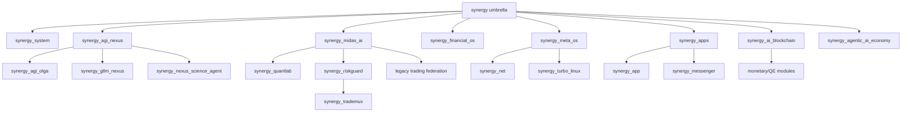

# SYNERGY MASTER GRAPH

M0 inventory: **81 repositories**.

## Domain counts

- **agi-agentic**: 10
- **apps-interface**: 6
- **architecture-governance**: 3
- **blockchain-protocol**: 4
- **compute-os**: 9
- **finance-economy**: 14
- **graph-research**: 1
- **presentation**: 2
- **protocol-transport**: 4
- **research-other**: 1
- **research-strategy**: 1
- **science-research**: 2
- **search-growth**: 1
- **trading-quant**: 23

## Maturity counts

- **ACTIVE_EXPERIMENTAL**: 5
- **ACTIVE_RESEARCH**: 1
- **ARCHITECTURAL_MASTER**: 3
- **CANDIDATE**: 32
- **HARDENED_ALPHA**: 1
- **LEGACY_RND**: 9
- **MODEL_SPEC_READY**: 1
- **PRESENTATION_CANDIDATE**: 3
- **RND**: 4
- **RND_CANDIDATE**: 1
- **RND_FEDERATION**: 1
- **RND_LOCAL_TESTING**: 1
- **RND_SCIENCE**: 1
- **RND_SIMULATION**: 1
- **SECURITY_BLOCKED**: 2
- **SECURITY_REVIEW**: 1
- **STUB_SPEC_ONLY**: 14

## Backbone dependency map

## Machine-readable graph

See [`registry/master_graph.json`](../registry/master_graph.json) for all nodes, capabilities and documented cross-repository edges.

## Important M0 classification corrections

- `synergy_search_engline` -> **finance-economy**, based on current README content.
- legacy trading repositories without SYNERGY in their name -> **federated-legacy**, because MIDAS references them.
- `binary_quantum_theory`, `dlp_solver`, `epstein_network` -> **federated research**.
- public GitHub Pages repositories -> **presentation surfaces**, not runtime authorities.
