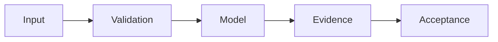

# SYNERGY Umbrella Registry — SCIENTIFIC DOSSIER V5

**Дата:** 24.10.2026. **Статус:** GOVERNANCE ROOT.

> Научно-технический source audit. Наличие кода, документации, тестов или workflow не означает фактического запуска, подтверждённой доходности или production readiness.

## Проблема и метод

Мастер-каталог исходников и модулей экосистемы SYNERGY.

## Проверенные исходники

- [registry/repos.json](../registry/repos.json)
- [scripts/rebuild_registry.py](../scripts/rebuild_registry.py)

## Формализация и проверка

Общее требование: отчёты должны связывать claim с commit SHA, данными, тестовыми параметрами и наблюдаемым raw output. 

**Acceptance:** Сверка инвентаря 81 старых / 86 доступных, не заявлять реальные интеграции по ссылкам.

## Ограничения и отрицательные результаты

Реестр от 8 октября описывает 81 репозиторий и требует переинвентаризации.

## Дальнейший инженерный план

1. Проверить версии зависимостей и воспроизводимость команд тестирования.
2. Добавить negative/adversarial controls, документировать failed-case.
3. Зафиксировать фактический CI verdict и привязанный SHA; не повышать зрелость из одного факта существования workflow.
4. Поддерживать границу между R&D, CANDIDATE и DEPLOYED.

Оформление по научному профилю [dlp_solver](https://github.com/Shtenco/dlp_solver) и [synergy_system](https://github.com/Shtenco/synergy_system). Исходный README сохранён.
